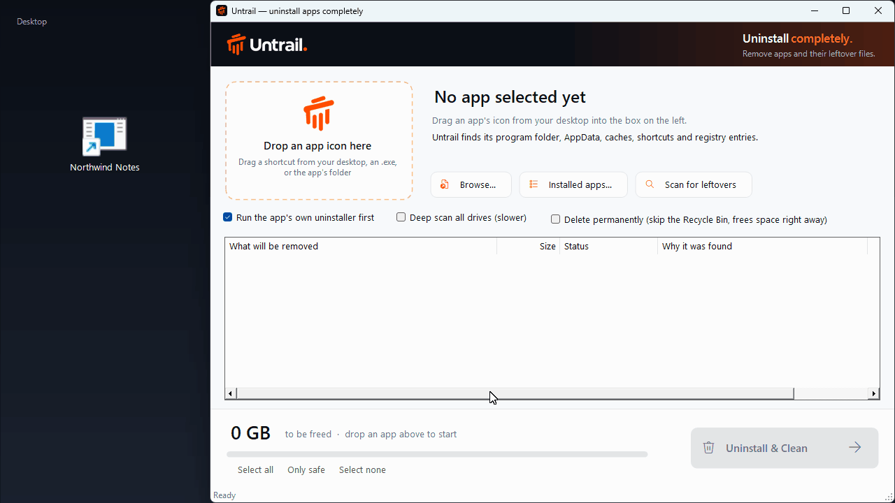
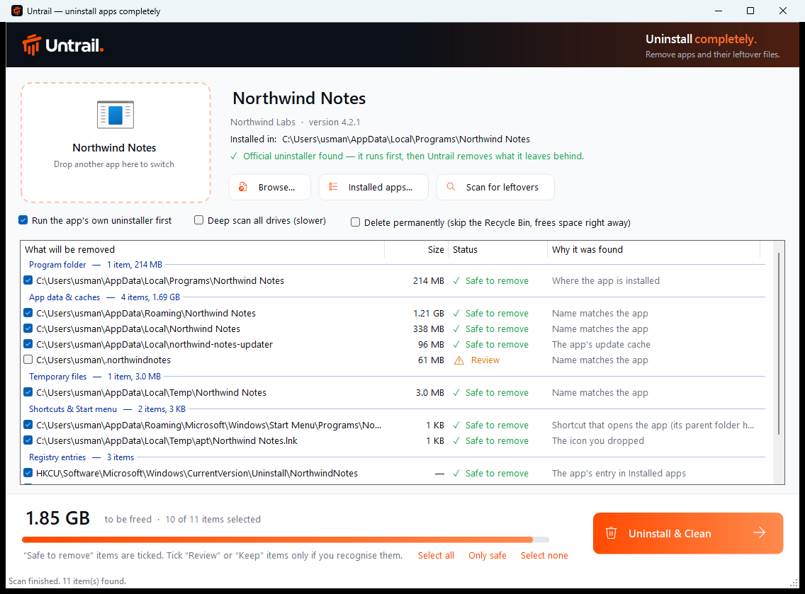
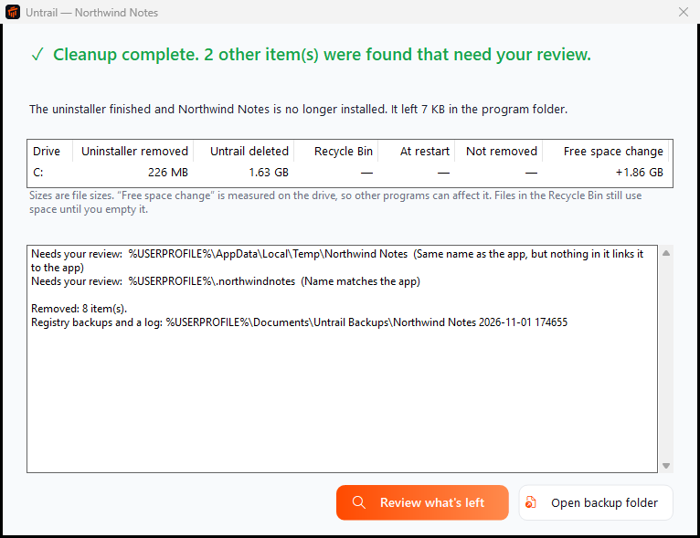

<p align="center">
  <picture>
    <source media="(prefers-color-scheme: dark)" srcset="brand/logo-dark.png">
    
  </picture>
</p>

<h3 align="center">Untrail — Uninstall completely.</h3>
<p align="center">Remove applications and the files they leave behind.</p>

<p align="center">
  <a href="https://usmanmateen.github.io/untrail/"><b>Website</b></a>
  &nbsp;·&nbsp;
  <a href="https://github.com/usmanmateen/untrail/releases/latest/download/UntrailSetup.zip"><b>⬇ Download the installer</b></a>
  &nbsp;·&nbsp;
  <a href="https://github.com/usmanmateen/untrail/releases/latest">Portable zip and all downloads</a>
</p>

<p align="center">
  <a href="https://github.com/usmanmateen/untrail/actions/workflows/ci.yml"></a>
  <a href="https://github.com/usmanmateen/untrail/actions/workflows/codeql.yml"></a>
  <a href="https://scorecard.dev/viewer/?uri=github.com/usmanmateen/untrail"></a>
  <a href="https://github.com/usmanmateen/untrail/releases/latest"></a>
  <a href="https://github.com/usmanmateen/untrail/releases"></a>
  <a href="LICENSE"></a>
</p>

Uninstalling an app on Windows often leaves a lot behind: caches and settings in AppData, update downloads, Start-menu shortcuts, start-up entries and registry keys. Some of these run to gigabytes. Untrail runs the app's own uninstaller, finds what's left, explains why each item belongs to the app, and removes what you approve.

## See Untrail in action



<sub>A real screen recording of Untrail removing a disposable demo app. It was made with <a href="tools/demo">tools/demo</a>, with <code>--hide-user</code> on so paths show as <code>%USERPROFILE%</code>.</sub>

<p align="center"></p>

## How it works

1. **Drag the app's icon into Untrail.** A desktop or Start-menu shortcut, the app's `.exe` or its install folder all work. You can also pick the app from **Installed apps…**.
2. **Review the list.** Every item shows its size, a safety rating and the reason it was found:
   - **✓ Safe to remove** is ticked for you. There's evidence the item belongs to this app.
   - **⚠ Review** is a likely match without enough proof. It stays unticked.
   - **✕ Keep** may hold your own files, for example in `Documents`. It stays unticked.
3. **Click Uninstall & Clean.**
   - The app's own uninstaller runs first, and Untrail waits for it to really finish. If it's cancelled or fails, Untrail stops and deletes nothing, unless you explicitly choose *Clean up anyway*.
   - Untrail then removes the leftovers you ticked and scans again to check what's still there.
   - Finally it shows a summary for each drive.

<p align="center"></p>

## Download

- **[Installer](https://github.com/usmanmateen/untrail/releases/latest/download/UntrailSetup.zip):** a zip with `UntrailSetup.exe`, install notes and the licence (also available as a [single .exe](https://github.com/usmanmateen/untrail/releases/latest/download/UntrailSetup.exe)). It installs for your Windows account only (no admin rights needed) and adds Untrail to the Start menu. To remove it, use **Settings → Apps → Installed apps → Untrail**.
- **Portable:** download `Untrail-<version>-portable.zip` from the [releases page](https://github.com/usmanmateen/untrail/releases/latest) and run `Untrail.exe`.
- **winget:** `winget install UsmanMateen.Untrail`, once the package is accepted into the Windows Package Manager.

It works on Windows 10 and 11 and uses the .NET Framework already built into Windows.

> **"Windows protected your PC"?** Untrail isn't code-signed yet, so SmartScreen may warn the first time. Choose **More info → Run anyway**. Each release includes `SHA256SUMS.txt` if you want to verify the download. Signing through the SignPath Foundation is being set up; see the [code signing policy](https://usmanmateen.github.io/untrail/code-signing.html), which also holds the privacy policy.

## What it can remove

- **Supported:** desktop apps installed with the usual Windows installers (MSI, NSIS, Inno Setup, Squirrel/Electron and similar), for your account or for all users; apps with no uninstaller (their folder is removed directly); and Steam games through their shortcuts.
- **Not supported:**
  - Microsoft Store apps. Use Settings → Apps.
  - Browser "web apps" such as Chrome or Edge shortcuts. Untrail recognises them and explains how to remove them in the browser.
  - Built-in Windows components.

## Updates

When a new version is released, Untrail shows a notice at the top of its window. **Update now** downloads `UntrailSetup.exe` from the GitHub release, checks it against the SHA-256 in that release's `SHA256SUMS.txt`, installs it silently and reopens Untrail. If the checksum doesn't match, nothing is run. You can also choose **Later** or **Skip this version**. A portable copy gets a **Download** link instead.

To find out about new versions, Untrail asks GitHub's public releases API for the latest release, at most once a day. That request sends nothing about you or your apps, and it's Untrail's only network use. Turn it off under **Settings → Check for updates automatically**, or run Untrail with `--no-update-check`.

## Normal scan and deep scan

The **normal scan** checks the places apps actually use:

| | |
|---|---|
| **Program folder** | `Program Files`, `Program Files (x86)`, `AppData\Local\Programs` |
| **App data & caches** | `AppData\Local`, `AppData\Roaming`, `AppData\LocalLow`, `C:\Users\you\.appname`, update caches |
| **Shared data** | `ProgramData` (`Common Files` is listed for review only, as it's shared by design) |
| **Temporary files** | `AppData\Local\Temp` |
| **Shortcuts** | Desktop, Start menu, pinned taskbar icons |
| **Registry** | The Installed-apps entry, `Software\<App>` settings, start-up entries, App Paths |
| **Your documents** | `Documents`, `Saved Games`. These are always marked **Keep**. |

**Deep scan** (optional, slower) also looks for folders named after the app anywhere on your fixed drives, up to four levels deep. Anything it finds is only ever marked **Review**.

## Safety

The guiding rule: when in doubt, leave it. Missing a leftover is better than deleting something that isn't the app's.

- **A name match is only a hint.** Before a same-named folder is marked *Safe to remove*, Untrail needs evidence that it belongs to the app. Evidence means it holds the app's own program files, its files mention the app's install folder, the app's registry settings point to it, it's the app's Electron data folder, or it sits in the publisher's own folder. Folders that are untouched since before the install, have common-word names or can't be read are marked *Review*.
- **Other apps' files are protected.** Folders that hold another installed app are never selected, even when they share a publisher. Neither are system folders or top-level folders like `Program Files`, `AppData` and `Documents`.
- **Links are never followed.** For junctions and symbolic links, only the link itself is removed, never its target. A path that has changed since the scan, such as one swapped for a link, is refused.
- **Every delete is re-checked.** Right before deleting, each item is checked again: against a fixed allowlist, against the identity of the app being removed, and against where it led at scan time. Registry deletion is limited to the app's own `Software` keys, its Installed-apps entry, App Paths and start-up entries.
- **No backup, no delete.** Registry entries are exported to `Documents\Untrail Backups` first. If the backup fails, the entry stays. A removal log is saved with the backups.
- **Admin rights only when needed.** Admin is requested only for `Program Files`, `ProgramData` or system-wide registry items. The admin helper gets its job over a private, verified connection from the Untrail window and applies all the checks above again.
- **Honest results.** After cleaning, Untrail scans again. It only says "No additional leftovers detected in scanned locations" when that scan finished and found nothing. It never claims *nothing* is left.

## How storage recovery is calculated

The results show each affected drive separately:

| Column | What it means |
|---|---|
| **Uninstaller removed** | Measured before and after the app's own uninstaller ran |
| **Untrail deleted** | What Untrail permanently deleted afterwards. Nothing is counted twice |
| **Recycle Bin** | Moved to the Recycle Bin. It still uses space until you empty the bin |
| **At restart** | Files in use that Windows will remove when you restart (listed by name) |
| **Not removed** | What couldn't be removed, and why |
| **Free space change** | The drive's free space measured before and after. It's the real number, but other programs can affect it |

The size columns are file sizes. On disk, compression and cluster sizes mean the space actually reclaimed can differ slightly, which is why the measured free-space change is shown too.

## Limitations

- Leftovers are found by name and then verified, so a folder with an unrelated name won't be found, and an unverified one is left for you to review.
- Don't start Untrail with "Run as administrator", because Windows blocks drag and drop into admin windows. Untrail asks for admin itself when it needs it.
- For files in use, Untrail can only schedule removal at restart when it has admin rights. Otherwise it reports them as not removed.
- `--hide-user` shows paths in your user folder as `%USERPROFILE%\…`, which is handy for screenshots.

## Building from source

Untrail is plain C# for .NET Framework 4.8. It's compiled with the `csc.exe` that ships with Windows, so no SDK or Visual Studio is needed.

```bash
powershell -ExecutionPolicy Bypass -File build.ps1 -Version 1.1.1
```

This writes `dist/Untrail.exe`, `dist/UntrailSetup.exe`, `dist/UntrailSetup.zip`, the portable zip and `SHA256SUMS.txt`.

| Path | What's there |
|---|---|
| `src/app` | The app: scanner, ownership checks, delete engine, uninstaller tracking, windows |
| `src/setup` | The installer (it embeds `Untrail.exe`) |
| `src/shared` | Brand theme and install/uninstall helpers used by both |
| `src/assets` | Logo and icon, generated from `brand/` by `tools/make_assets.py` |
| `tests` | Integration tests |
| `tools/demo` | Scripts that produce the README screenshots and demo recording |
| `site` | The website, deployed to [usmanmateen.github.io/untrail](https://usmanmateen.github.io/untrail/) by `.github/workflows/pages.yml` |

To see what a scan would find without changing anything:

```bash
Untrail.exe --scan "C:\Users\you\Desktop\Some App.lnk" --out report.txt
```

## Tests

`tests/integration.ps1` installs throwaway fake apps, runs the real delete path and checks every result. It covers:

- **Ownership evidence:** name collisions, old same-name folders, unreadable folders.
- **Shared folders:** shared install folders, and a decoy app from the same publisher.
- **Links:** junctions and symbolic links, inside a leftover and as a leftover.
- **Uninstallers:**
  - an NSIS-style one that hands off to a hidden copy of itself;
  - a cancelled one, then an explicit manual cleanup afterwards;
  - one that only partly uninstalls.
- **Failures:** a registry backup that fails, and a file locked by a running process.
- **Recycle Bin versus permanent deletion.**
- **Storage accuracy:** the uninstaller's removals plus Untrail's must equal everything found, to the byte.
- **The admin helper:** it must refuse items outside the app's identity.
- **The delete allowlist self-test.**

The tests run on every push on GitHub's disposable Windows machines, where the admin-only scenarios run too. They're safe to run locally: the fixtures are fake "Zephyr" apps, and the script stops if any fixture path already exists.

```bash
powershell -ExecutionPolicy Bypass -File tests/integration.ps1 -Exe dist/Untrail.exe
```

## Releasing

Push a version tag. GitHub Actions builds on Windows, signs the app and installer (once [code signing](docs/code-signing.md) is configured), runs the tests, attests the build provenance, publishes the installer, portable zip and checksums, and opens the [winget](docs/winget.md) update:

```bash
git tag v1.2.0 && git push origin v1.2.0
```

## Contributing

Found something Untrail missed, or matched wrongly? Open a [leftover report](https://github.com/usmanmateen/untrail/issues/new?template=leftover_report.yml). That's the most useful contribution there is. For code changes, see [CONTRIBUTING.md](CONTRIBUTING.md). Every pull request runs the build, the integration tests, PowerShell lint, a spell check, CodeQL, dependency review and a workflow audit, and `main` only accepts changes through pull requests that pass them.

Security problems: please report them privately, as described in [SECURITY.md](SECURITY.md).

## License

[MIT](LICENSE)
